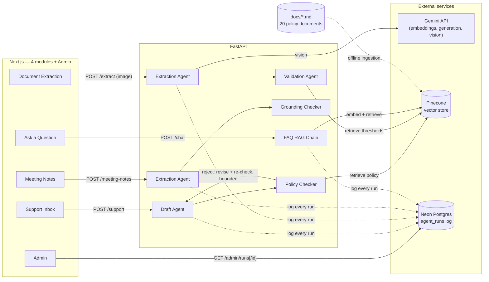

# Fynbos Ops Console

An internal automation platform for a fictional South African online retailer, bundling four distinct agent
workflows under one dashboard: a customer support inbox, supplier invoice extraction, meeting-notes-to-action-items,
and a policy chatbot. Each of the first three pairs a drafting agent with an independent checking agent before
accepting the output — but the three checkers work differently from each other, because each domain calls for a
different answer to "what does it mean to check this."

> **Fynbos Retail is entirely fictional.** The company, its policies, and every document in [`docs/`](./docs)
> were invented for this project. None of it describes a real business, and nothing in it is real retail,
> financial, or legal advice.

---

## Why this exists

Most systems that pair a drafting agent with a checking agent apply one classify-and-audit pattern to a single
task. This project asks what that pattern looks like applied to several genuinely different automation tasks
inside one company — support replies, invoice extraction, and meeting notes — rather than one task done well
once. The answer differs each time: a checker that corrects, a checker that only routes, and a checker that
filters, each argued for below.

## Architecture



**Support Inbox (`POST /support`):** a Draft Agent classifies an incoming customer email and drafts a reply. A
Policy Checker Agent independently retrieves relevant policy text and checks both the category and every specific
factual claim in the reply (timelines, eligibility, fees) against it. On rejection, the Draft Agent revises — and
critically, the revision is re-checked, not accepted on faith. That re-check exists because it caught a real bug
during development: an earlier version fixed one flagged error in a reply and, in the process, silently
introduced a different one that nothing had flagged. See Key Engineering Decisions.

**Document Extraction (`POST /extract`):** an Extraction Agent reads an uploaded invoice image via Gemini's
multimodal input and pulls structured fields. A Validation Agent checks it — but doesn't correct anything.
Arithmetic reconciliation is deterministic Python, not LLM judgment, because a language model rewriting a number
to make it balance would hide a real invoice error rather than surface it. The Validation Agent's only job is to
route the result (auto-approve / needs manager approval / needs finance director approval / flagged) by reading
Fynbos's actual Rand thresholds from retrieved policy text.

**Meeting Notes (`POST /meeting-notes`):** an Extraction Agent produces a summary and a list of action items from
a transcript. A Grounding Checker Agent verifies each item independently against the transcript text. Here too
the checker doesn't correct — an ungrounded action item can't be rewritten into a true one, so the only safe move
is to drop it. The "correction" is a deterministic filter, not another generation pass.

**Ask a Question (`POST /chat`):** a single-agent RAG chain over the same policy corpus, for general staff
questions. Two independent guardrails gate an answer: a similarity threshold calibrated against this specific
corpus, and an explicit prompt rule that a bare keyword ("returns policy") is a request to summarize, not a
reason to refuse — a bug found in a previous project's chatbot after it shipped, built in from the start here
instead of discovered later.

**Admin (`/admin`):** all four modules log to one `agent_runs` table (a `module` column plus JSONB payloads,
rather than four separate tables), so this is a single activity feed across the whole console, filterable by
module, not four disconnected admin pages.

**Ingestion is offline**, not part of any live request path: a script chunks every document in `docs/` along its
own numbered section boundaries, embeds each chunk, and upserts it to Pinecone with metadata that lets a
retrieved chunk be cited and returned directly.

## Key engineering decisions

- **A revision that fixes one error can introduce another, and the original design had no way to catch that.**
  During Support Inbox testing, a rejected draft's revision correctly fixed a wrong shipping-cost claim - and, in
  the same revision, changed a previously-correct refund timeline to an incorrect one. The single-revision,
  never-re-checked design had no mechanism to catch a regression introduced by its own fix. Fixed by having the
  Checker re-verify every revision, bounded to 2 extra attempts. Confirmed with a repeated test: the same email
  rejected on 4 separate runs, for three
  different reasons each time, and all 4 resolved to consistent, correct final answers. The eval set later showed
  this isn't a rare case - 6 of 8 Support cases were rejected on their first pass, every one corrected.
- **Not every "agent checks agent" pattern should default to auto-correct.** Support's checker corrects because a
  wrong reply can legitimately be rewritten by the same agent that drafted it. Extraction's checker never
  corrects a number - it routes or flags, because an LLM "fixing" a financial figure to make it balance would
  hide a real error rather than surface it, and arithmetic reconciliation is deterministic Python for the same
  reason: models are not reliable calculators. Meeting Notes' checker corrects by deterministic filtering, not
  generation - an ungrounded action item can't be rewritten into a grounded one, so the only safe move is to drop
  it. Three modules, three considered answers, not one template applied three times.
- **The Grounding Checker's ability to actually catch a fabrication was verified directly, not inferred.** Two
  natural-language test transcripts each included an idea someone floated but didn't commit to, specifically to
  see whether the Extraction Agent would over-list it as an action item. It didn't, either time - which meant the
  Checker never got a live chance to reject anything end-to-end. Rather than treat a clean run as sufficient
  proof the safety mechanism works, the Checker was called directly with three hand-constructed action items (one
  real, two fabricated) against a real transcript. It kept the real one and correctly rejected both fabrications
  with accurate, specific reasoning. A mechanism that's never been triggered isn't a mechanism that's been
  verified.
- **A confidence threshold was recalibrated for this corpus, not reused from the last project.** The chatbot's
  similarity threshold is set from this corpus's own measured gap (0.624 out-of-domain ceiling, 0.717 in-domain
  floor) rather than carrying over a prior project's number, which would have been coincidental rather than
  correct.

## Evaluation results

Three separate eval sets, one per module with a checker agent - the chatbot's dual-guardrail behavior was
verified directly in its own dedicated test set during development rather than duplicated here.

| Module | Metric | Result |
|---|---|---|
| Support Inbox | Final category correct (8 cases) | 8/8 |
| Document Extraction | Vendor + PO detection + approval routing correct (4 cases) | 4/4 |
| Meeting Notes | Expected items kept, no over-extraction (3 cases) | 3/3 |

**15/15 overall.** The more informative number sits inside the Support Inbox result: 6 of the 8 cases were
rejected by the Policy Checker on their first pass - mostly the same class of specific-claim error found during
manual testing (a slightly wrong timeline, an incorrect fee waiver) - and the revise-and-recheck loop corrected
every one to the right final answer. That's a stronger demonstration of why the two-agent design matters than any
single curated example, because it wasn't selected for the write-up - it's what the eval run actually did.

Full per-case breakdown: [`backend/eval/eval_results.md`](./backend/eval/eval_results.md). Re-run it with
`cd backend && python scripts/eval.py` (needs the same env vars as the app - see Setup below; the Document
Extraction cases call Gemini's vision endpoint, so a full run takes several minutes).

## Tech stack

| Layer | Choice |
|---|---|
| Frontend | Next.js (TypeScript) + Tailwind + shadcn/ui |
| Backend | Python + FastAPI |
| Orchestration | LangChain - structured-output agent chains, multimodal input for extraction |
| Generation | Gemini (`gemini-3.5-flash-lite`), including vision input |
| Embeddings | Gemini (`gemini-embedding-001`) |
| Vector store | Pinecone (serverless) |
| Relational DB | Neon Postgres - unified agent run log |

## Project structure

```
docs/               20 fictional policy documents (the corpus)
frontend/
  app/               Support Inbox (/), Document Extraction (/extract), Meeting Notes (/meeting-notes),
                      Ask a Question (/chat), Admin (/admin, /admin/[id])
backend/
  app/               FastAPI app: per-module agent files (support_agent.py, extraction_agent.py,
                      meeting_agent.py, rag_chain.py), retrieval, DB
  scripts/           CLI tools: ingest.py, eval.py, generate_test_invoices.py, per-module manual test scripts
  eval/              Evaluation sets + results
```

## Setup

Requires: Node.js 20+, Python 3.12+, and API keys/accounts for Gemini, Pinecone, and Neon.

**Backend**
```bash
cd backend
python -m venv .venv
.venv/Scripts/activate   # or source .venv/bin/activate on macOS/Linux
pip install -r requirements.txt
```

Create `backend/.env`:
```
GEMINI_API_KEY=...
PINECONE_API_KEY=...
PINECONE_INDEX_NAME=fynbos-retail-policies
NEON_DATABASE_URL=postgresql://...
```

Create the agent run log table in Neon:
```sql
create table agent_runs (
  id uuid primary key default gen_random_uuid(),
  module text not null,
  input jsonb not null,
  draft jsonb,
  verdict text,
  critique text,
  final jsonb,
  citations text[],
  created_at timestamptz not null default now()
);
```

Then run ingestion once to populate Pinecone:
```bash
python scripts/ingest.py
```

Start the API:
```bash
uvicorn app.main:app --reload --port 8000
```

**Frontend**
```bash
cd frontend
npm install
```

Create `frontend/.env.local`:
```
NEXT_PUBLIC_API_URL=http://localhost:8000
```

```bash
npm run dev
```

## API

`POST /support`
```json
// Request
{ "email_text": "My blender arrived with a cracked lid, can you help?" }

// Response
{
  "draft": { "category": "Damaged/Defective Item", "draft_reply": "..." },
  "checker": { "verdict": "approved", "citation": "Damaged & Defective Items Policy §1", "critique": "", "corrected_category": "" },
  "final": { "category": "Damaged/Defective Item", "draft_reply": "..." },
  "citations": ["Damaged & Defective Items Policy §1", "..."]
}
```

`POST /extract` — multipart file upload (`file`, PNG/JPEG/WEBP) → `{ extraction, arithmetic, validation, citations }`

`POST /meeting-notes` — `{ transcript }` → `{ summary, all_action_items, grounding_results, final_action_items, citations }`

`POST /chat` — `{ question }` → `{ answer, sources }`

`GET /admin/runs?module=...`, `GET /admin/runs/{id}` — unified activity feed and detail, filterable by module.

No authentication or rate limiting on any endpoint - internal tool, not a public-facing surface.

## Known limitations

- Document Extraction accepts PNG/JPEG/WEBP only. PDF was in the original scope note but wasn't implemented or
  tested, and isn't claimed as working.
- No deployment yet - the project runs locally.
- No authentication on the Admin UI or any endpoint, appropriate for an internal-tool demo but not for a
  production deployment handling real customer or financial data.
